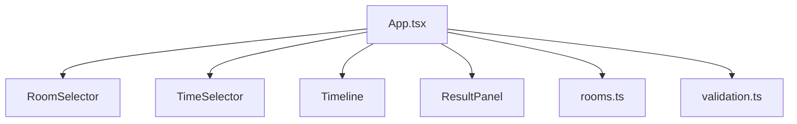
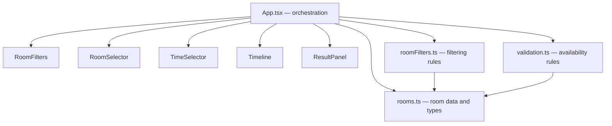

# Software Engineering — Assignment #04
## Smart Campus Room Availability Checker

**Project:** React + TypeScript + Vite  
**AI assistant:** ChatGPT (GPT-6)  
**Date:** 11 November 2026

---

## Task 01 — Codebase analysis

### Repository map

```text
src/
├── App.tsx                       # Page composition and application state
├── main.tsx                      # React entry point
├── components/
│   ├── Header.tsx                # Application heading and fixed demo time
│   ├── RoomSelector.tsx          # Room cards and selection
│   ├── RoomFilters.tsx           # Capacity/equipment filter controls (new)
│   ├── TimeSelector.tsx          # Time interval input
│   ├── Timeline.tsx              # Selected room schedule visualization
│   └── ResultPanel.tsx           # Availability feedback
├── data/
│   └── rooms.ts                  # Room, Booking and Interval types + fictional data
└── lib/
    ├── validation.ts             # AC1–AC5 availability rules
    ├── validation.test.ts        # Existing regression tests
    ├── roomFilters.ts             # Pure room filtering logic (new)
    └── roomFilters.test.ts        # New filter/integration tests
```

### Existing behavior

The original implementation already contained five fictional rooms and separate availability validation. The availability logic checks interval boundaries, the 120-minute limit, blocked rooms and interval overlap. The overlap condition uses strict comparisons, so intervals touching at endpoints are allowed. The validation function reads the room's own booking list and does not add a booking.

### Maintainability risks found

1. `src/App.tsx`: application state, event handling and page composition are held in one component. This can become difficult to maintain as more interactions are added.
2. `src/data/rooms.ts`: the original Room interface had no equipment field, so the new equipment requirement could not be represented.
3. `src/components/RoomSelector.tsx`: the component originally rendered all supplied rooms and had no capacity/equipment filtering controls.
4. `src/lib/`: there was no dedicated room-filtering module or tests for filter behavior.

### Prioritized plan

1. Extend the Room model and fictional room records with equipment.
2. Implement pure filtering logic in a dedicated module.
3. Add capacity and equipment controls to the UI.
4. Show a clear empty state when no room matches.
5. Clear stale selection/result state when filters or selected room change.
6. Add regression and new feature tests; run tests, lint, typecheck and production build.

### AI suggestion modified/rejected

A broad rewrite of `validation.ts` was not accepted. Inspection showed that its strict overlap check and room-specific booking lookup already matched the required behavior. Rewriting stable validation code would increase regression risk without being necessary for the new requirements. The existing validation implementation was preserved.

---

## Task 02 — Feature extension

### Room catalog

The application contains five fictional rooms. Each room has an ID, name, building, capacity, equipment list, type, blocked status and its own bookings.

### Filtering behavior

- Capacity: a room is included when `room.capacity >= minimumCapacity`.
- Equipment: a room is included only when it contains every selected equipment item (`every`).
- Empty state: if the filtered result is empty, the UI explains that no rooms match and suggests relaxing the filters.
- Room switching: selecting another room clears the previously displayed result until the user checks availability again.
- Filter changes: the selected room and old result are cleared so a result for a room outside the new filtered catalog is not left on screen.
- Blocked rooms may be shown in the catalog, but availability validation rejects them.

### New/changed files

- `src/data/rooms.ts`: added `equipment` to the Room interface and all five room records.
- `src/lib/roomFilters.ts`: pure filtering function and equipment options.
- `src/components/RoomFilters.tsx`: capacity input, equipment checkboxes and clear control.
- `src/components/RoomSelector.tsx`: displays equipment labels with room details.
- `src/App.tsx`: integrates filtering, empty state and selection reset behavior.
- `src/lib/roomFilters.test.ts`: tests filtering and selected-room availability integration.

---

## Task 03 — Refactoring

### Before



### After



### Design decisions

1. Filtering is implemented as a pure function in `roomFilters.ts`, separate from React presentation. This makes the rule independently testable and prevents UI event handlers from duplicating the filter algorithm.
2. Availability validation remains in `validation.ts`. Room filtering and time-slot validation are separate responsibilities; keeping them separate avoids mixing catalog search rules with booking rules.
3. The selected room and result are reset after filter changes. This prevents a stale availability result from being displayed for a room that is no longer in the filtered list.

---

## Task 04 — Automated testing

### Test inventory

The project contains 30 test cases across the existing validation suite and the new room-filter suite.

The existing validation tests cover AC1–AC5, including invalid intervals, the 120/121-minute boundary, blocked rooms, overlap, endpoint touching and booking-data preservation.

The new tests cover:
- No active filters.
- Exact capacity match.
- Insufficient capacity.
- All-selected-equipment matching.
- Empty filter result.
- Catalog immutability.
- Filtered room passed into availability validation using that room's own booking data.
- Blocked room rejected by availability validation.

### Commands

```bash
npm test
npm run lint
npm run typecheck
npm run build
```

### Execution evidence and environment limitation

In the supplied execution environment:
- `npm run lint` passed.
- `npm run typecheck` passed.
- `npm test` could not start: the packaged Vitest executable returned `Permission denied`. Direct Node invocation then failed because the Linux optional dependency `@rollup/rollup-linux-x64-gnu` was absent from the uploaded `node_modules`.
- `npm run build` was blocked by the same missing Rollup Linux optional dependency.
- An attempt to install the missing optional dependency timed out.

These are environment/dependency setup failures. They are not reported as test assertion failures, and no passing Vitest or production-build result is claimed. Run the four commands above in a clean environment after installing dependencies to obtain final execution evidence.

---

## Task 05 — Quality evaluation

| Measure | Original | Updated | Evidence / interpretation |
|---|---:|---:|---|
| Room catalog | 5 rooms | 5 rooms | `src/data/rooms.ts` |
| Capacity/equipment filtering | Not implemented | Implemented | `src/lib/roomFilters.ts` |
| Automated test cases authored | Existing validation suite | 30 total | Test files; execution still requires dependency repair |
| Dedicated filtering module | 0 | 1 | `src/lib/roomFilters.ts` |
| Dedicated filtering UI component | 0 | 1 | `src/components/RoomFilters.tsx` |
| Duplicated filter logic removed | N/A | N/A | Original version had no filter implementation to duplicate |
| Remaining limitation | — | Test/build environment | Linux Rollup optional dependency is missing from supplied `node_modules` |

The source-level quality improvements are modular filtering, explicit room equipment data, an empty state, and stale-selection prevention. Runtime test/build status remains unverified in this environment.

---

## Task 06 — AI reflection (200–300 words)

I used ChatGPT (GPT-6) as an AI assistant during the analysis and extension of the Smart Campus Room Availability Checker. I provided the assignment requirements, the uploaded project archive, its repository structure, and the existing acceptance criteria AC1–AC6. I asked the assistant to inspect the current implementation before proposing changes, rather than replacing the application with a new version.

The most useful recommendation was to keep room filtering separate from time-slot validation. This led to a dedicated `roomFilters.ts` module and a separate `RoomFilters.tsx` component. The assistant also identified that the Room interface did not contain equipment data, which was necessary to implement the all-required-equipment rule. I did not accept a suggested broad rewrite of the existing availability validator because its strict interval-overlap condition and room-specific booking lookup were already suitable. Rewriting it would create unnecessary regression risk.

I personally reviewed the Room interface, all five room records, the filtering function, and the React state changes. I also checked that filtering requires every selected equipment item, that capacity equality is accepted, and that changing filters clears the previous selection and result. The existing validation tests were retained, and new tests were added for filtering and the selected-room availability flow.

The test environment exposed a missing Linux Rollup optional dependency. Linting and TypeScript typechecking passed, but the automated test suite and production build could not be executed successfully here. I therefore recorded this limitation instead of claiming unverified results. Next, I would install dependencies in a clean local environment, run all tests, inspect the interface at mobile and desktop sizes, and capture terminal evidence.

---

## AI-use record

| Field | Record |
|---|---|
| Tool/model | ChatGPT / GPT-6 |
| Date | 11 November 2026 |
| Prompt summary | Inspect the uploaded Smart Campus project against Assignment #04; identify maintainability risks; add capacity/equipment filters while preserving existing validation. |
| Output used | Repository analysis, improvement plan, filter module, filter UI, tests and documentation structure. |
| Problems found | Existing archive contained Windows-oriented/incomplete dependencies for execution in the Linux environment. |
| Human review | Source files, acceptance criteria, TypeScript typecheck and ESLint output. |
| Verification sources | Project source, test files, assignment slides and actual command output. |

